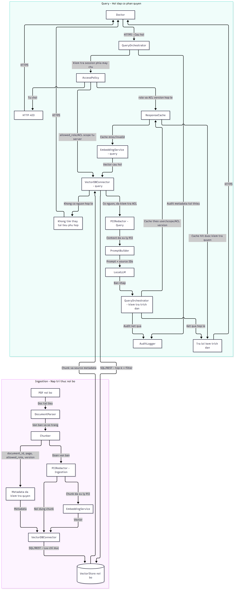
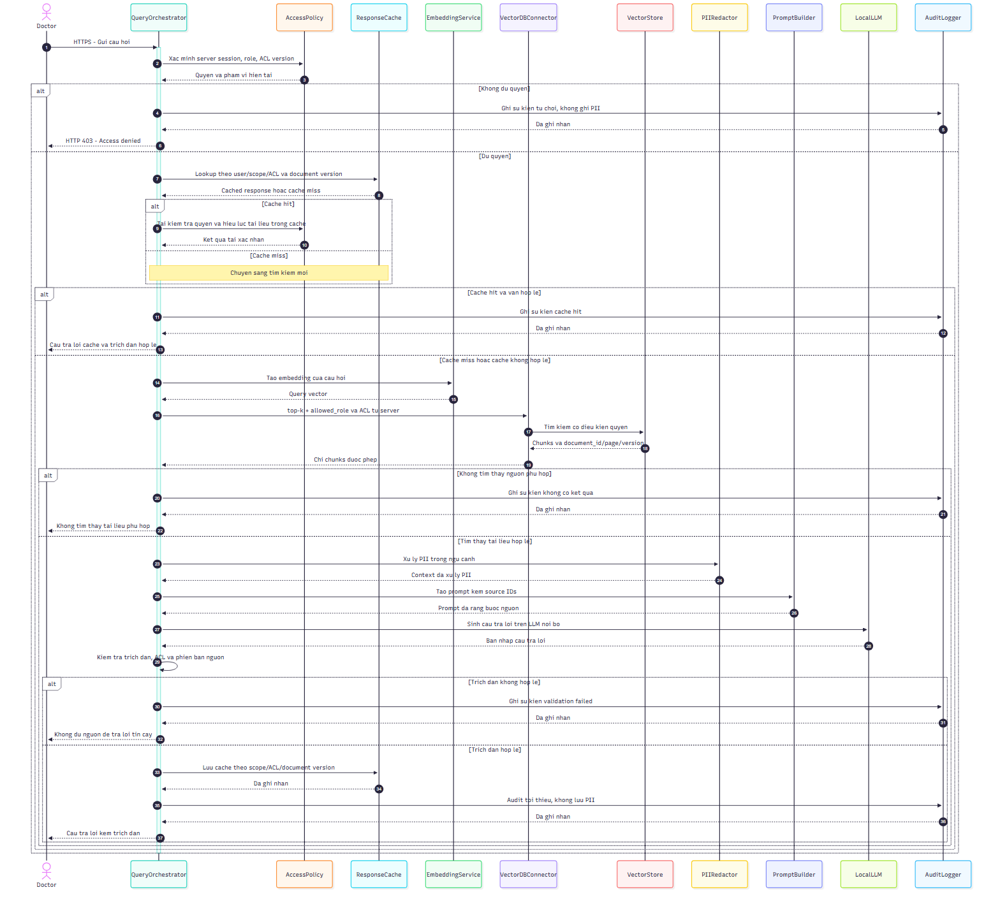

# LAB 4 - RAG Architecture Design

## 1. Architectural Drivers

### 1.1. Bối cảnh

Hệ thống IMRS bổ sung tính năng Trợ lý tra cứu
phác đồ sử dụng kiến trúc RAG trên khoảng
5.000 tài liệu PDF nội bộ.

Hệ thống phải thực hiện tra cứu theo quyền
người dùng và tạo câu trả lời có trích dẫn.

Các ràng buộc:
- Dữ liệu không rời mạng nội bộ bệnh viện.
- 1 GPU RTX 4090.
- Ngân sách 15.000 USD.
- Thời hạn triển khai 4 tháng.

### 1.2. Bảng Architectural Drivers

| Mã | Nhóm | Mô tả | Liên quan ASR/ràng buộc Lab 1 | Mức ưu tiên | Nguồn |
|---|---|---|---|---|---|
| F01 | Chức năng | Tìm kiếm đoạn phác đồ liên quan | Yêu cầu tra cứu IMRS; cần đối chiếu Lab 1 | Cao | Chưa phân loại |
| F02 | Chức năng | Trả lời có trích dẫn tài liệu nguồn | Yêu cầu chức năng Lab 4 | Cao | Chưa phân loại |
| F03 | Chức năng | Nạp, trích xuất và chia đoạn PDF | Phân hệ RAG mới | Cao | Chưa phân loại |
| Q01 | ASR | Đáp ứng yêu cầu TTFT | ASR hiệu năng Lab 1; chưa có ngưỡng cụ thể | Cao | Chưa phân loại |
| Q02 | ASR | Phân quyền tài liệu theo vai trò | ASR bảo mật; cần đối chiếu Lab 1 | Rất cao | Chưa phân loại |
| Q03 | ASR | Có khả năng thay thế mô hình embedding | ASR Modifiability; cần đối chiếu Lab 1 | Cao | Chưa phân loại |
| Q04 | ASR | Kiểm soát thông tin PII | Ràng buộc bảo mật dữ liệu | Rất cao | Chưa phân loại |
| C01 | Ràng buộc | Dữ liệu không rời mạng nội bộ | Ràng buộc Lab 1 | Rất cao | Chưa phân loại |
| C02 | Ràng buộc | Hạ tầng có 1 GPU RTX 4090 | Ràng buộc hạ tầng Lab 1 | Cao | Chưa phân loại |
| C03 | Ràng buộc | Ngân sách 15.000 USD | Ràng buộc ngân sách Lab 1 | Cao | Chưa phân loại |
| C04 | Ràng buộc | Thời hạn 4 tháng | Ràng buộc tiến độ Lab 1 | Cao | Chưa phân loại |

### 1.3. Nhận xét

Các drivers được phân thành ba nhóm:
yêu cầu chức năng, ASR và ràng buộc.

Q01, Q02 và Q03 ảnh hưởng trực tiếp đến
lựa chọn công nghệ và tổ chức các thành phần RAG.

C01 yêu cầu embedding, VectorStore và LLM
được triển khai hoàn toàn trong mạng nội bộ.

### 1.4. Những nội dung cần đối chiếu Lab 1

- Ngưỡng TTFT cụ thể.
- ASR hiệu năng và bảo mật.
- Công nghệ database hiện có.
- Các thành phần kiến trúc từ Lab 2-3.

### 1.5. Đánh giá đề xuất của AI

Cần đối chiếu đầu ra AI ban đầu với báo cáo
Lab 1 để xác định driver bị thiếu, bị diễn đạt
sai hoặc được AI tự đề xuất không có căn cứ.

## 2. So sánh phương án kiến trúc RAG

### 2.1. D1 - Lựa chọn Vector Database

| Tiêu chí | Qdrant nội bộ | pgvector nội bộ | Managed Cloud |
|---|---|---|---|
| Độ trễ | Phụ thuộc cấu hình và tải hệ thống | Phụ thuộc truy vấn SQL, index và tài nguyên PostgreSQL | Phụ thuộc kết nối mạng và dịch vụ |
| Bảo mật | Dữ liệu được lưu trong mạng bệnh viện | Dữ liệu được lưu trong mạng bệnh viện | Không phù hợp nếu dữ liệu rời mạng |
| Chi phí | Cần tài nguyên triển khai và vận hành riêng | Có thể tận dụng PostgreSQL nếu đã có | Chi phí dịch vụ và truyền dữ liệu |
| Vận hành | Quản lý một dịch vụ Vector DB riêng | Có thể tận dụng kinh nghiệm PostgreSQL | Nhà cung cấp quản lý hạ tầng |
| Khả năng thay thế | Có thể trừu tượng qua VectorDBConnector | Có thể trừu tượng qua VectorDBConnector | Có nguy cơ phụ thuộc nhà cung cấp |
| Ràng buộc | Phù hợp | Phù hợp có điều kiện | Không phù hợp với triển khai cloud thông thường |

**Đề xuất:** Sử dụng pgvector nếu PostgreSQL
đã có trong hạ tầng IMRS và đáp ứng yêu cầu
về tài nguyên, hiệu năng.

**Lý do:** Có thể giảm số lượng dịch vụ cần
vận hành, tích hợp SQL và quản lý metadata.

**Rủi ro:** Truy vấn vector có thể cạnh tranh
tài nguyên với các nghiệp vụ khác của database.

**Cần xác minh:** PostgreSQL có sẵn trong
kiến trúc Lab 1-3 hay không.

### 2.2. D2 - Lựa chọn Embedding Service

| Tiêu chí | Embedding nội bộ | Embedding Cloud API |
|---|---|---|
| Độ trễ | Phụ thuộc CPU/GPU nội bộ | Phụ thuộc mạng và nhà cung cấp |
| Bảo mật | Có thể giữ dữ liệu trong bệnh viện | Cần gửi nội dung đến API bên ngoài |
| Chi phí | Tài nguyên máy chủ, bảo trì | Phí API theo mức sử dụng |
| Vận hành | Tự triển khai và bảo trì | Nhà cung cấp vận hành |
| Khả năng thay thế | Có thể thay qua interface chung | Phụ thuộc API và định dạng |
| Ràng buộc | Phù hợp | Không phù hợp |

**Đề xuất:** Sử dụng mô hình embedding
mã nguồn mở đa ngôn ngữ chạy nội bộ.

**Lý do:** Không phải gửi tài liệu hoặc câu hỏi
ra API bên ngoài bệnh viện.

**Rủi ro:** Cần đánh giá tài nguyên tính toán.
Khi đổi mô hình embedding, có thể phải tạo
lại vector cho toàn bộ kho tài liệu.

### 2.3. D3 - Lựa chọn cơ chế phân quyền

| Tiêu chí | Pre-filter | Post-filter | Collection theo vai trò |
|---|---|---|---|
| Bảo mật | Kiểm soát quyền trong truy vấn | Rủi ro nếu dữ liệu trái quyền đi vào xử lý trung gian | Cách ly logic theo nhóm |
| Độ trễ | Phụ thuộc hiệu quả truy vấn có lọc | Có thể cần truy xuất bổ sung | Phụ thuộc số collection |
| Số kết quả | Có thể tìm trong tập hợp hợp lệ | Có thể ít hơn k | Phụ thuộc collection được chọn |
| Vận hành | Quản lý metadata và policy | Đơn giản ban đầu nhưng có rủi ro | Phức tạp khi có nhiều vai trò |
| Khả năng thay đổi | Linh hoạt theo metadata | Dễ sửa logic nhưng khó bảo đảm an toàn | Có thể phải tổ chức lại dữ liệu |
| Phù hợp IMRS | Đề xuất lựa chọn | Không ưu tiên | Phù hợp một số trường hợp |

**Đề xuất:** Pre-filter theo allowed_role,
kết hợp AccessPolicy phía máy chủ.

**Lý do:** Tránh đưa các đoạn tài liệu không
được phép truy cập vào ngữ cảnh LLM.

**Rủi ro:** Sai sót metadata hoặc cấu hình
AccessPolicy có thể làm truy xuất sai quyền.

**Biện pháp:** Kiểm thử phân quyền, bảo đảm
vai trò lấy từ phiên xác thực của máy chủ,
và giới hạn quyền truy cập trực tiếp Vector DB.

### 2.4. Giải thích Pre-filter và Post-filter

Pre-filter đưa điều kiện phân quyền vào truy vấn
trước khi kết quả được chuyển cho các bước xử lý
tiếp theo. Cơ chế này hỗ trợ chiến thuật bảo mật
Authorize Actors vì chỉ dữ liệu đáp ứng chính sách
truy cập mới được sử dụng để tạo câu trả lời.

Post-filter thực hiện tìm kiếm trước rồi mới
loại bỏ các kết quả không được phép xem.

Ví dụ: Hệ thống tìm top-5 đoạn tài liệu nhưng
có 2 đoạn không thuộc quyền truy cập của bác sĩ.
Sau khi lọc, chỉ còn 3 đoạn hợp lệ.

Do vậy, post-filter có thể trả về ít hơn k nếu
không có bước truy xuất bổ sung.

Lưu ý: Pre-filter trong logic ứng dụng không
đồng nghĩa mọi chỉ mục ANN đều thực hiện lọc
vật lý trước khi tìm kiếm. Việc bảo vệ dữ liệu
cần được bảo đảm ở các lớp truy cập và xử lý.

## 3. Kiểm chứng khẳng định kỹ thuật của AI

### 3.1. Mục đích

Kiểm chứng các khẳng định kỹ thuật do ChatGPT
đề xuất trong quá trình so sánh phương án
kiến trúc RAG cho hệ thống IMRS.

Việc kiểm chứng dựa trên tài liệu chính thức
của Qdrant và pgvector.

### 3.2. Bảng kết quả kiểm chứng

| Mã | Khẳng định của AI | Kết quả | Giải thích | Nguồn kiểm chứng |
|---|---|---|---|---|
| K01 | Qdrant hỗ trợ lọc metadata bằng payload filtering | Đúng | Qdrant hỗ trợ sử dụng điều kiện lọc payload khi tìm kiếm hoặc truy xuất vector. | https://qdrant.tech/documentation/search/filtering/ |
| K02 | pgvector hỗ trợ tìm kiếm tương đồng Cosine | Đúng | pgvector hỗ trợ toán tử cosine distance và chỉ mục tương ứng. | https://github.com/pgvector/pgvector#querying |
| K03 | pgvector có thể kết hợp SQL WHERE với tìm kiếm vector | Đúng, có lưu ý | pgvector hỗ trợ lọc SQL WHERE. Với approximate indexes, việc lọc có thể xảy ra sau khi quét chỉ mục, ảnh hưởng số kết quả. | https://github.com/pgvector/pgvector#filtering |

### 3.3. Đánh giá khả năng phát hiện vi phạm PII

Trong kết quả so sánh, ChatGPT đã phát hiện
hai phương án không phù hợp với ràng buộc
dữ liệu nội bộ của IMRS:

1. Managed Vector Database Cloud:
   Có thể yêu cầu chuyển dữ liệu hoặc vector
   ra ngoài mạng nội bộ bệnh viện.

2. Embedding Cloud API:
   Yêu cầu gửi văn bản đầu vào đến dịch vụ
   của nhà cung cấp để tạo embedding.

Hai phương án trên không đáp ứng ràng buộc
dữ liệu không được rời mạng nội bộ bệnh viện
trong cách triển khai cloud thông thường.

Do đó, ChatGPT đã nhận diện được ràng buộc
bảo mật quan trọng này trong bài toán.

### 3.4. Nhận xét và điều chỉnh

Qua kiểm chứng, ba khẳng định được lựa chọn
đều đúng về chức năng cơ bản.

Tuy nhiên, đối với pgvector, cần phân biệt
giữa việc áp dụng điều kiện quyền trong truy
vấn SQL và thứ tự thực thi bộ lọc trong
approximate nearest neighbor search.

Không thể kết luận rằng mọi truy vấn có WHERE
đều thực hiện lọc trước khi quét vector index.

Vì vậy, kiến trúc cần có AccessPolicy phía
máy chủ, kiểm tra metadata phân quyền,
và các thử nghiệm xác nhận rằng nội dung
trái quyền không đi vào ngữ cảnh LLM.

### 3.5. Kết luận

Các tài liệu chính thức hỗ trợ lựa chọn
Qdrant hoặc pgvector làm Vector Store nội bộ.

Quyết định cuối cùng cần căn cứ vào hạ tầng
IMRS hiện có, các ASR của Lab 1 và kết quả
đánh giá hiệu năng thực tế.

<CodeBlock language="markdown" editable>

### 5.4. Hình sơ đồ kiến trúc RAG

## 6. Sequence Diagram - RAG Query

### 6.1. Mục đích

Sequence Diagram mô tả quá trình tương tác
giữa các thành phần của phân hệ RAG khi
bác sĩ gửi câu hỏi tra cứu phác đồ.

### 6.2. Mô tả quy trình

1. Bác sĩ gửi câu hỏi đến QueryOrchestrator.
2. AccessPolicy xác thực quyền phía máy chủ.
3. Nếu không đủ quyền, hệ thống từ chối truy cập.
4. Nếu đủ quyền, hệ thống kiểm tra ResponseCache.
5. Nếu cache hợp lệ, trả câu trả lời đã lưu.
6. Nếu cache miss, EmbeddingService tạo vector.
7. VectorDBConnector tìm kiếm với allowed_role.
8. Nếu không có tài liệu, trả thông báo phù hợp.
9. Nếu có tài liệu, PIIRedactor xử lý PII.
10. PromptBuilder tạo prompt có thông tin nguồn.
11. LocalLLM sinh câu trả lời.
12. QueryOrchestrator kiểm tra trích dẫn.
13. AuditLogger ghi lại sự kiện cần thiết.
14. Hệ thống trả câu trả lời có trích dẫn.

### 6.3. Hình Sequence Diagram

### 6.4. Mã Mermaid

Mã nguồn được lưu tại:
- rag-sequence-ai-original.mmd
- rag-sequence-final.mmd

### 6.5. Nhận xét

Sequence Diagram thể hiện cơ chế kiểm tra
quyền truy cập trước khi truy xuất dữ liệu.

Dữ liệu không được phép truy cập không
được đưa vào ngữ cảnh LLM.

PIIRedactor xử lý thông tin nhạy cảm trước
bước xây dựng prompt và sinh câu trả lời.

Sơ đồ cũng thể hiện các nhánh từ chối truy cập,
cache hit, cache miss và không tìm thấy tài liệu.

Các thành phần được triển khai trong mạng
nội bộ bệnh viện theo ràng buộc của IMRS.

## 7. Đánh giá và hiệu chỉnh sơ đồ do AI sinh

### 7.1. Phương pháp kiểm tra

Sơ đồ Flowchart và Sequence Diagram do ChatGPT
sinh được kiểm tra bằng Mermaid Live Editor.

Các tiêu chí kiểm tra gồm:
- Cú pháp Mermaid hợp lệ.
- Tên thành phần nhất quán với Lab 2-3.
- Kiểm tra quyền truy cập phía máy chủ.
- PIIRedactor đứng trước LocalLLM.
- Có AuditLogger và ResponseCache.
- Các mũi tên có nhãn hành động hoặc giao thức.
- Có nhánh xử lý khi không tìm thấy tài liệu.

### 7.2. Bảng lỗi và chỉnh sửa

| STT | Sơ đồ | Lỗi hoặc thiếu sót thực tế | Cách chỉnh sửa | Kết quả |
|---|---|---|---|---|
| 1 | Flowchart | [Điền sau kiểm tra] | [Điền thay đổi thực tế] | [Kết quả] |
| 2 | Flowchart | [Điền sau kiểm tra] | [Điền thay đổi thực tế] | [Kết quả] |
| 3 | Sequence | [Điền sau kiểm tra] | [Điền thay đổi thực tế] | [Kết quả] |
| 4 | Sequence | [Điền sau kiểm tra] | [Điền thay đổi thực tế] | [Kết quả] |

### 7.3. Kết luận

Phiên bản sơ đồ cuối cùng được rà soát theo
các yêu cầu chức năng, ASR và ràng buộc của IMRS.

Mọi chỉnh sửa thực tế được ghi nhận trong
bảng trên và nhật ký AI_LOG.md.

## 8. Tổng kết và quyết định kiến trúc

### 8.1. Kết quả đạt được

Trong Lab 4, phân hệ Trợ lý tra cứu phác đồ
của IMRS đã được phân tích và thiết kế
ở mức kiến trúc thành phần.

Các kết quả chính gồm:

1. Xác định Architectural Drivers cho RAG.
2. So sánh ba điểm quyết định D1, D2, D3.
3. Kiểm chứng các khẳng định kỹ thuật của AI.
4. Thiết kế Flowchart cho Ingestion và Query.
5. Thiết kế Sequence Diagram cho truy vấn RAG.
6. Xây dựng hai Architecture Decision Records.
7. Ghi nhật ký sử dụng AI và các chỉnh sửa.

### 8.2. Phương án kiến trúc đề xuất

D1 - Vector Store:
Ưu tiên pgvector trên PostgreSQL nội bộ,
với điều kiện hạ tầng hiện có và ASR phù hợp.
Qdrant self-hosted là phương án dự phòng.

D2 - Embedding:
Ưu tiên mô hình embedding đa ngôn ngữ
mã nguồn mở, triển khai trong mạng nội bộ.

D3 - Phân quyền:
Sử dụng pre-filter kết hợp AccessPolicy
phía máy chủ và kiểm tra quyền phòng vệ.

### 8.3. Các vấn đề chưa được xác minh

- Hạ tầng PostgreSQL thực tế của IMRS.
- Ngưỡng TTFT cụ thể trong Lab 1.
- Khả năng đáp ứng tải khi chia sẻ RTX 4090.
- Độ trễ truy vấn vector theo bộ dữ liệu thực tế.
- Chất lượng embedding trên thuật ngữ y khoa.
- Chi phí triển khai và vận hành chi tiết.

### 8.4. Bài học về AI-Assisted Architecting

AI hỗ trợ đề xuất phương án, tổ chức bảng
so sánh và sinh mã sơ đồ kiến trúc.

Tuy nhiên, các kết quả AI cần được kiểm chứng,
phản biện và điều chỉnh để phù hợp với ràng buộc
của hệ thống IMRS.

Sinh viên chịu trách nhiệm về các quyết định
kiến trúc cuối cùng và ghi nhận quá trình
sử dụng AI trong AI_LOG.md.
